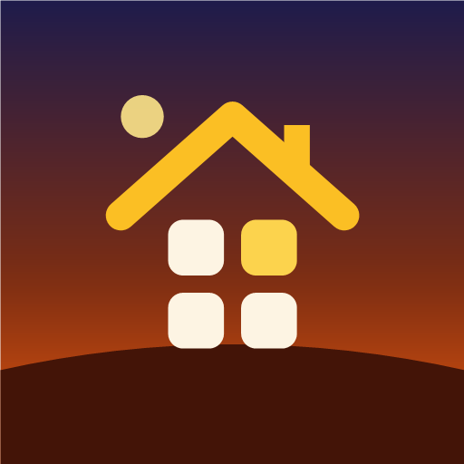
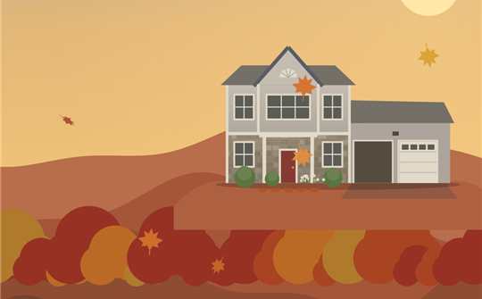
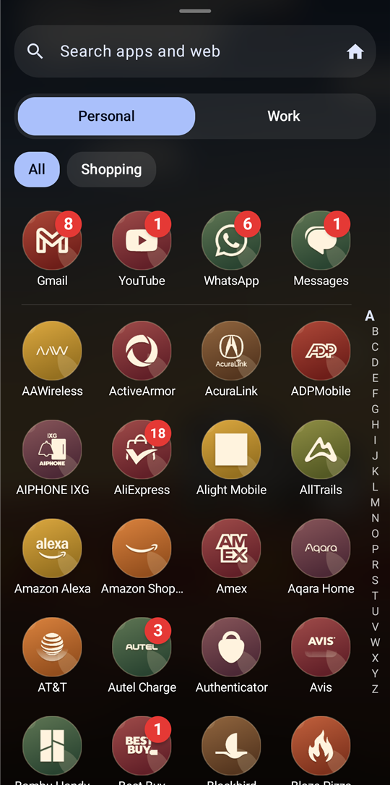
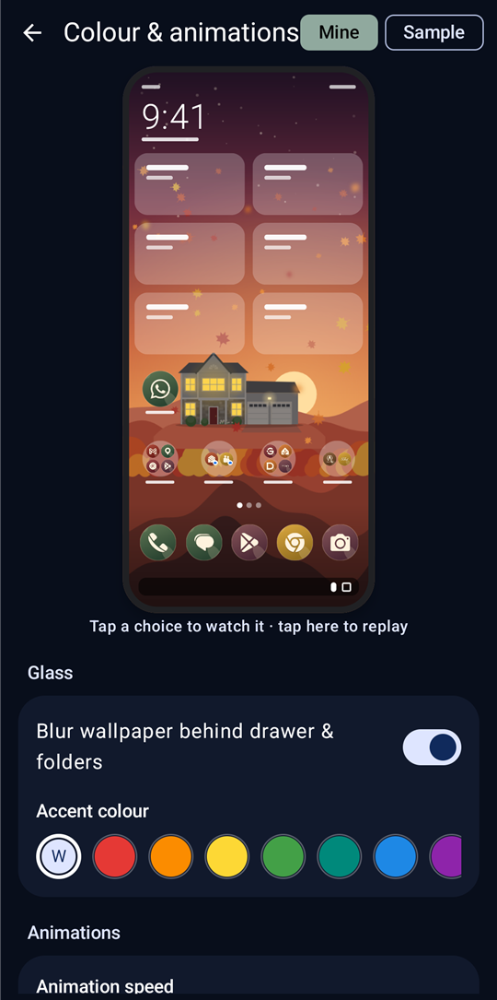
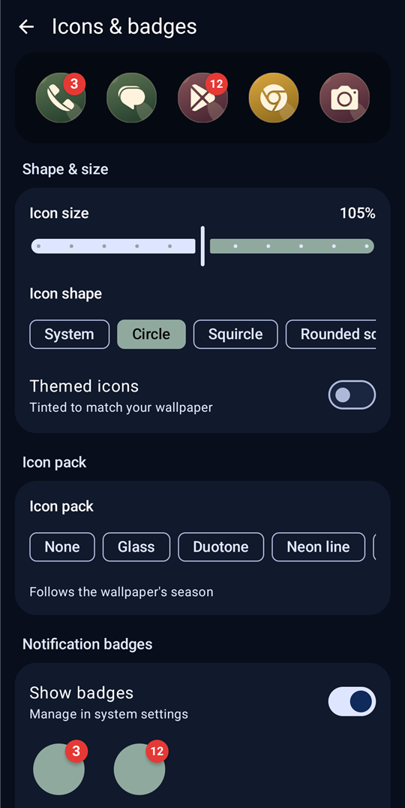
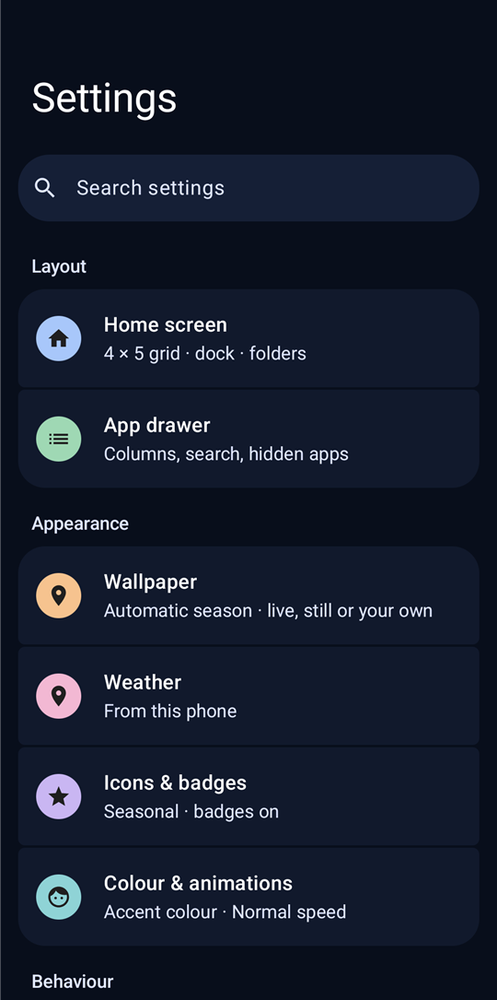

  

<h1 align="center">Roof Access</h1>

<b>A clean, classic Android home screen with your smart home built in.</b>

Roof Access is an icon-grid launcher for Android 8 and up. It works well as an everyday home screen on its own. If you use
[Home Assistant](https://www.home-assistant.io/), it also brings your lights, locks, garage and alarm onto your home
screen, and puts a picture of your house on the wallpaper that changes with what's happening at home.

> Roof Access is an unofficial app. It isn't made by or affiliated with Home Assistant or the Open Home Foundation. It
> connects only to your own server.

  

▶️ <a href="docs/visitor-demo.mp4"><b>Watch a visitor arrive at the house</b></a> (short video)

  
  
  
  

---

## What you get

### A home screen that stays out of your way
- **Your grid, your size:** choose the number of columns and rows, show or hide labels, and keep a dock along the bottom.
- **Folders, widgets and pages:** drop one app onto another to make a folder, add widgets, and reorder your pages.
- **Gestures you choose:** swipe up for your apps and down for notifications, and set what double-tap and pinch do.
- **Fast search:** find apps, contacts and the web from one box, or ask Claude or Gemini.
- **Private apps:** hide apps from the drawer and, if you like, keep them behind your fingerprint.

### Make it look like yours
- **Seasonal live wallpaper:** a hillside scene that follows the season and the time of day, with real weather such as rain, snow and fog.
- **Icons and badges:** change icon size and shape, use themed or icon-pack icons, and show notification dots or counts.
- **Animations:** pick how apps open, how pages turn and how folders and menus appear, with a live preview in settings.
- **At a glance:** the clock, date, weather and your next calendar event sit at the top of the home screen.

### Your smart home on the home screen (optional)
- **Device tiles:** tap to switch lights, run scenes, lock doors or open the garage. Long-press a tile for full controls.
- **Safe by default:** unlocking a door, opening the garage or disarming the alarm asks for your fingerprint first.
- **Alerts under the clock:** see at a glance when the alarm is armed, a door is open, a leak is detected or a battery is low.
- **Your house on the wallpaper:** choose a house style and size. Windows light up when the lights inside are on, garage
  doors open and close, your car appears in the driveway, and little figures walk in and out as people come and go.

### Easy to move in, easy to keep
- **Coming from Nova Launcher?** Import your Nova layout in one step.
- **Backups:** save your setup to a file or Google Drive, or let it back up automatically.

---

## Can I trust it with my home?

It's a fair question: a Home Assistant token gives access to your devices. Here's how Roof Access handles it, and how you
can check for yourself.

- **Your token stays on your phone.** It's kept in the app's private storage, is never included in backups, and is only
  ever sent to the Home Assistant server you entered.
- **No account, no ads, no analytics, no tracking.** The developer never receives any of your data.
- **You can see every connection it makes.** The full list is short, and you can confirm it with a free firewall app.
  See [How to check what Roof Access connects to](VERIFY.md).
- **You stay in control.** Delete the token in Home Assistant and the app is cut off instantly.
- **Risky actions need your fingerprint.** Unlocking, opening the garage and disarming the alarm ask for it first.

For extra peace of mind, you can give Roof Access its own Home Assistant user. See [Using a separate Home Assistant user](VERIFY.md#using-a-separate-home-assistant-user).

The full [privacy policy](PRIVACY.md) explains everything the app accesses and why.

---

## Getting started

1. **Install the app** on your phone.
2. **Make it your home screen.** Press the Home button, pick **Roof Access**, then tap **Always**. You can also do
   this later in **Settings → Home screen → Set as default home app**.
3. **Follow the welcome steps.** Roof Access asks only for what it needs, such as notification access for badges.
   Everything is optional and can be changed later.

### Connecting Home Assistant (optional)
1. In Home Assistant, open **Profile → Security → Long-lived access tokens** and create a token.
2. In Roof Access, long-press an empty spot on the home screen and open **Settings → Home Assistant (unofficial)**.
3. Enter your server address (for example `http://homeassistant.local:8123`) and paste the token.
   If you reach Home Assistant from outside your home, also add your **Away-from-home URL** (such as your Nabu Casa address).
4. Pick your **Favorite devices**, then add their tiles to your home screen.
5. Optional: turn on **Show the house** and choose a style. In the same section, match the garage doors, front door,
   car and each window's light to your own devices.

### Tips
- **Long-press an empty spot** for wallpaper, widgets and settings.
- **Long-press an app** for its shortcuts and app info, or to move or remove it.
- **Settings has a search box,** so you can type what you're looking for, such as "badges" or "garage".

---

## Feedback and bugs

Found a bug or have an idea? [Open an issue](../../issues/new/choose). Please don't include your token, server address
or anything else private in an issue.

What's new in each version is in the [changelog](CHANGELOG.md).

---

## About this repository

This repository holds Roof Access's information pages, release notes and issue tracker. The app's source code is
private. Copyright © 2026 Sarcastic Worm. All rights reserved. See [LICENSE](LICENSE).
